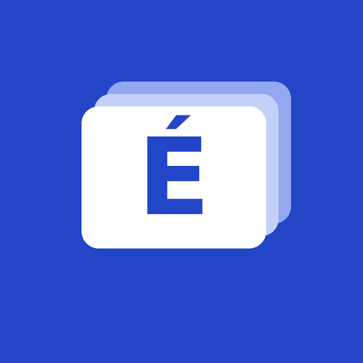

<div align="center">



# Édito Leitner

**Learn every word of Édito A1, A2 and B1 with a Leitner box — on your iPhone, offline, no App Store.**

[](https://djsoroush.github.io/edito-leitner/)


</div>

<p align="center">
  
  &nbsp;
  
  &nbsp;
  
</p>

---

## Why this app

The Édito books have thousands of words, and reading word lists doesn't make them stick. Édito Leitner shows each word at the right moment: words you miss come back tomorrow, and words you know well wait days or weeks. Ten minutes a day is enough to move through all three books before the TCF Canada exam.

## Features

| | |
|---|---|
| 🗂️ **All of Édito A1–B1** | 3,123 words in book order (A1: 865 · A2: 990 · B1: 1,268), from Unité 1 to Unité 12 |
| 🔁 **Automatic Leitner system** | The app decides what to review each day and moves every card to the right box |
| 🏷️ **Clear status on every card** | `NEW`, `BOX 3 · REVIEW` or `AGAIN`, and a message after each answer telling you where the card went |
| 🇮🇷 **Persian meanings** | Every word and every example sentence is translated into Persian |
| ♂️♀️ **Masculine and feminine** | Articles in colour (**le** in blue, **la** in red), plus the other form when it exists: *le chanteur → la chanteuse*, *beau → belle* |
| 🔊 **French audio** | Hear the word and the example sentence, using the iPhone's built-in French voice — works offline |
| 🖼️ **Pictures** | Small pictures for about 780 concrete words (food, animals, places, objects) |
| 🔍 **Word list** | Search in French or Persian; filter by New, In boxes, Hard or Learned |
| 👋 **Personal greeting** | *Bonjour, Bon après-midi, Bonsoir* or *Bonne nuit* with your name, depending on the time |
| 🎉 **End-of-session message** | *Félicitations !* and a list of the words to watch |
| 📴 **Works offline** | After the first visit, everything works with no internet |
| 💾 **Back up and restore** | Save your progress to a file and move it to another phone |

## How the Leitner boxes work

Every card starts as **New**. Each answer moves it:

- ✅ **I knew it** → the card moves **up one box**
- ❌ **Didn't know** → the card goes **back to Box 1**, and comes back again a few cards later in the same session

| Box | Next review |
|:---:|:---|
| New | Today, as one of your daily new words (20 by default, adjustable) |
| 1 | in 1 day |
| 2 | in 2 days |
| 3 | in 4 days |
| 4 | in 8 days |
| 5 | in 16 days |
| ★ Learned | in 90 days, as a quick check |

A new word you already know skips Box 1 and goes straight to Box 2. Each session starts with the weakest boxes, then mixes in your new words. Missing a day loses nothing: those cards simply wait for your next session.

## Install on iPhone (no App Store)

1. Open **[djsoroush.github.io/edito-leitner](https://djsoroush.github.io/edito-leitner/)** in **Safari**.
2. Tap **Share** (the square with an arrow) → **Add to Home Screen** → **Add**.
3. Open the new **Édito** icon once while you have internet. After that it works offline and opens full-screen like a normal app.

> **Tip:** to get an update, open the app with internet, close it fully, then open it again.

It also works in any browser on a computer, where you can use the keyboard: **Space** to flip, **←** for *Didn't know*, **→** for *I knew it*.

<div dir="rtl">

### نصب روی آیفون (بدون اپ استور)

۱. لینک بالا را در **Safari** باز کنید.
۲. روی **Share** بزنید و **Add to Home Screen** را انتخاب کنید.
۳. یک بار با اینترنت باز کنید؛ بعد از آن بدون اینترنت هم کار می‌کند.

</div>

## Your progress

Progress is saved **on your device only** — there is no account and nothing is sent anywhere. To move to a new phone, or to keep a copy, use **Back up progress** on the home screen and **Restore from backup** on the other device. Deleting the app from your Home Screen also deletes its progress, so make a backup first.

## Under the hood

A single-page **Progressive Web App** with no frameworks and no build step:

```
index.html             the whole app (HTML, CSS, JavaScript)
vocab.json             3,123 words: word, IPA, part of speech, Persian, example, level, unit, gender, other form, picture
sw.js                  service worker that caches everything for offline use
manifest.webmanifest   app name, icon and full-screen mode
icon-*.png             app icons
docs/                  screenshots for this page
```

## Credits

- Made by **Soroush**.
- Vocabulary lists, Persian meanings and example sentences come from the [b-amooz Édito collection](https://lang.b-amooz.com/fr/vocabulary/book-collection/10/edito). *Édito* is published by Didier. This project is for personal study and is not affiliated with either.
- Masculine and feminine forms were generated from French spelling rules plus a list of exceptions. If you spot a mistake, please open an issue.
